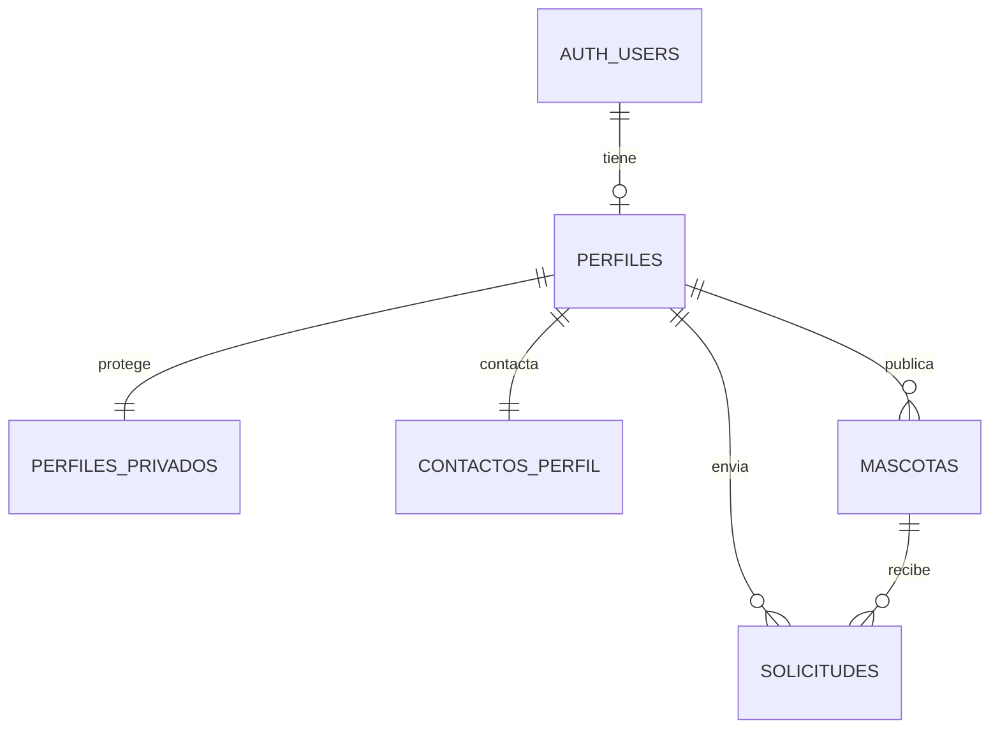

# Integración con David y Dylan

## Identificador común

Todos usan el mismo proyecto Supabase y el mismo UUID del usuario. No crees otra tabla independiente de login ni generes un id diferente para relacionar mascotas.

| Origen | Identificador |
|---|---|
| Supabase Auth | `auth.users.id` |
| Perfil visible | `public.perfiles.id` |
| Datos privados | `public.perfiles_privados.usuario_id` |
| Contacto | `public.contactos_perfil.usuario_id` |
| En C# después de iniciar sesión | `AppServices.Api.UserId` |

`perfiles.id` es a la vez clave primaria y clave foránea hacia `auth.users.id`. Las otras dos tablas del perfil comparten esa identidad. Se separan para aplicar diferentes permisos a los campos.



`MASCOTAS` y `SOLICITUDES` son relaciones propuestas para integrar; esta entrega no crea esas tablas. `cuentas_en_eliminacion` es una tabla interna del servidor, sin lectura ni escritura para el cliente, que bloquea la cuenta mientras se limpia.

## Acceso a los datos

| Información | Visitante | Usuario con sesión |
|---|---|---|
| Nombres, apellidos, ciudad | Visible en perfil público | Visible |
| Foto de perfil | Bucket privado; opcional, con ícono predeterminado si falta | URL temporal cuando existe |
| Dirección y celular | Sin acceso | Puede consultar los contactos de perfiles activos |
| Cédula y nacimiento | Sin acceso | Solo el titular |
| Contraseña | Nunca disponible | Supabase Auth la administra |

La dirección de la mascota puede publicarse con una ubicación general diferente de la dirección personal. Eviten poner la cédula, el correo o el nacimiento en las consultas del catálogo. El permiso de contacto entre usuarios registrados responde al requisito de poder contactar al propietario; el equipo puede restringirlo después a solicitudes válidas si cambia el alcance.

## Relaciones que debe añadir el equipo

Cuando existan las tablas correspondientes, definan estas claves foráneas (ejemplos; no ejecutar antes de crear esas tablas):

```sql
-- En mascotas:
propietario_id uuid not null references public.perfiles(id) on delete cascade

-- En solicitudes/intereses:
solicitante_id uuid not null references public.perfiles(id) on delete cascade
mascota_id uuid not null references public.mascotas(id) on delete cascade

-- En notificaciones:
destinatario_id uuid not null references public.perfiles(id) on delete cascade
```

Agreguen índices a esas columnas. Para evitar intereses repetidos, acuerden una restricción `unique(mascota_id, solicitante_id)` o una regla equivalente según el ciclo de solicitudes. No creen un sistema de favoritos duplicado si «interés» será la misma solicitud de adopción.

Los `ON DELETE CASCADE` son una propuesta para esta primera versión: al eliminar una cuenta se borran sus publicaciones y relaciones dependientes. Deben revisar la política de historial antes de guardar adopciones definitivas que quieran conservar. Las imágenes no se borran por una clave foránea; necesitan la limpieza de Storage.

## Abrir una pantalla que necesita login

En el evento de tocar una mascota, David puede usar:

```csharp
using PetMatch.Services;

await AppFlow.RequireAsync(this, () => new DetalleMascotaPage(mascotaId));
```

`DetalleMascotaPage` representa la vista que David escribirá. El método conserva el destino: si se necesita login, lo pide, comprueba el perfil y después abre la vista indicada.

El catálogo público puede abrirse sin sesión. Los detalles con datos personales, registrar interés y publicar necesitan sesión válida y perfil completo. Ocultar un botón no reemplaza los permisos de la base.

Para abrir el perfil propio:

```csharp
await AppFlow.RequireAsync(this, () => new PetMatch.Views.ProfilePage());
```

`ProfilePage.cs` ya tiene accesos a Inicio, publicar, publicaciones propias, intereses y notificaciones. Cambien `new IntegrationPage(...)` por sus páginas reales.

## Consultas desde los otros módulos

El servicio mantiene el token y añade las cabeceras de autenticación:

```csharp
var perfilId = AppServices.Api.UserId;

var json = await AppServices.Api.AuthorizedAsync(
    HttpMethod.Post,
    "/rest/v1/rpc/ver_perfil_contacto",
    new { p_usuario = propietarioId });
```

Esta RPC devuelve un arreglo con id, nombres, apellidos, ciudad, `avatar_path`, dirección y celular. No incluye datos privados. Se debe comprobar el arreglo vacío cuando el perfil ya no existe o está en proceso de eliminación.

Para una foto vinculada:

```csharp
var fotoTemporal = await AppServices.Api.AvatarUrlAsync(avatarPath);
```

La URL dura cinco minutos. No la almacenen en la base de datos; guarden `avatar_path` y generen otra URL cuando sea necesario.

Para abrir WhatsApp desde el detalle que implementará David:

```csharp
using Microsoft.Maui.ApplicationModel;

var numero = perfilCelular.TrimStart('+'); // Se almacena como +5939XXXXXXXX.
await Launcher.Default.OpenAsync(new Uri($"https://wa.me/{numero}"));
```

El botón puede mostrar el número en grande y un ícono de WhatsApp. El número proviene del contacto normalizado, nunca de texto arbitrario pegado en una URL.

## Reglas RLS que deben continuar en mascotas y solicitudes

Para crear o modificar una publicación, la política debe exigir al menos:

```sql
propietario_id = (select auth.uid())
and public.cuenta_disponible((select auth.uid()))
```

Para una solicitud, `solicitante_id = auth.uid()` impide atribuirla a otra persona. Para administrarla, el servidor debe verificar que la mascota pertenece al usuario autenticado. Validar estas identidades en C# solamente sería insuficiente.

La lectura anónima debe restringirse a mascotas disponibles y no vencidas, con propietarios activos. El catálogo expone únicamente campos apropiados para visitantes; cualquier dato privado debe consultarse después del login.

## Requisitos de mascotas que quedan para el equipo

| Requisito del usuario | Responsable de implementación |
|---|---|
| Feed vertical y carga incremental como TikTok | David |
| Foto, información general, ubicación y publicador | David + consultas acordadas |
| Detalle con fotos, salud, raza, color y contacto | David |
| Botón de interés y lista de intereses/solicitudes | David |
| Máximo 5 publicaciones activas por usuario | Dylan; validación transaccional en servidor |
| Entre 1 y 5 fotos por mascota | Dylan; app, Storage y finalización de publicación |
| Nombre opcional; edad, raza, sexo, salud y ubicación | Dylan |
| Vacunas opcionales y comentario de hasta 500 caracteres | Dylan |
| Borrar publicación cuando se concreta la adopción | Dylan |
| Avisos al propietario y revisión del interesado | Dylan + David |
| Vencimiento a los 10 días, retiro del catálogo y aviso | Dylan / trabajo compartido de backend |

Para garantizar el límite de cinco bajo peticiones simultáneas, no basta con contar filas en el teléfono. Usen una RPC/transacción con bloqueo por propietario. Las fotos pueden cargarse primero como borrador; la publicación se hace visible solo cuando el servidor confirma entre una y cinco fotos.

La expiración debe ejecutarse en el servidor mediante una tarea programada, incluso si la app está cerrada. Un filtro por `vence_en > now()` retira la mascota del catálogo inmediatamente, mientras una tarea completa la limpieza y crea el aviso. El texto del aviso debe indicar «venció el plazo de 10 días»; no afirmar que nadie respondió si sí hubo interesados. El usuario vuelve a publicar si la mascota sigue disponible.

La limpieza de cuenta incluida contempla los buckets `avatars` y `pet-photos`, con rutas planas `<usuario_uuid>/<archivo_uuid.ext>`. Si Dylan utiliza subcarpetas u otros buckets debe ampliar la función de limpieza antes de activar bajas en la app integrada. Nunca eliminen filas de `storage.objects` para simular borrado de archivos: utilicen la API de Storage.

## Orden de integración

1. Acordar nombres de tablas y claves foráneas de este contrato.
2. Ejecutar y probar el esquema de perfiles en el proyecto común.
3. Integrar el catálogo público de David en `HomePage`.
4. Usar `RequireAsync` para el detalle y las acciones protegidas.
5. Sustituir las pantallas `IntegrationPage` por las de cada responsable.
6. Añadir políticas de seguridad, limpieza de fotos y expiración.
7. Probar juntos: visitante → registro → publicar → ver detalle → interés → notificación → adopción o vencimiento.

## Integración móvil actual

La aplicación inicia en `StartupPage`, restaura la sesión de Supabase si está configurado y abre `HomePage`. El inicio presenta el catálogo compartido cuando hay conexión y conserva un catálogo SQLite para uso local sin backend.

Para habilitar el detalle compartido, sus fotos y la lista de solicitudes enviadas, ejecutar también `supabase/05_detalle_mascota.sql` después de las migraciones `01` a `04`. La migración devuelve únicamente los datos públicos de la mascota y agrega la consulta de solicitudes propias.
